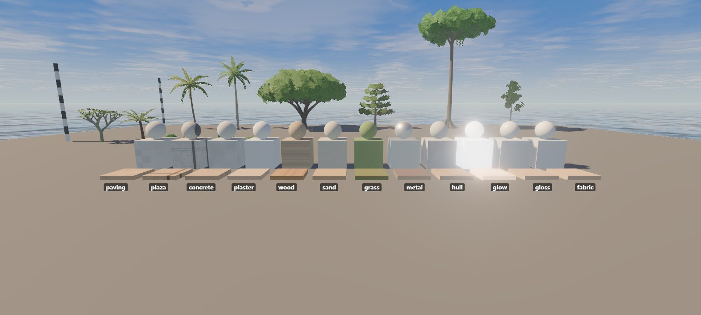
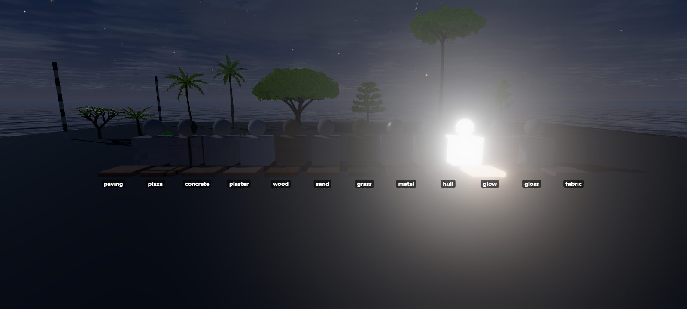
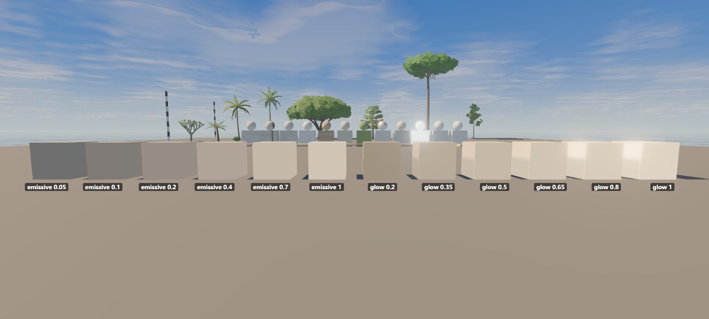
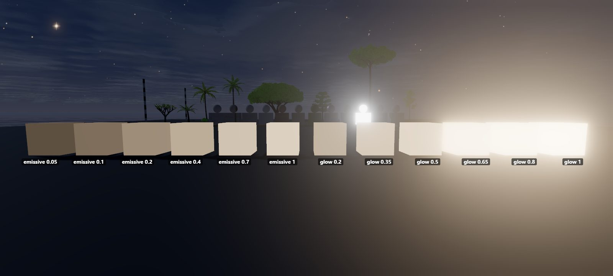
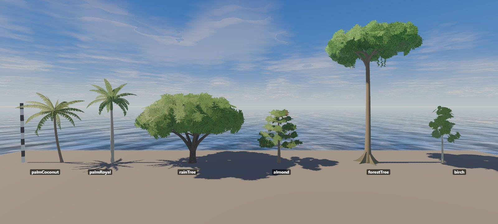
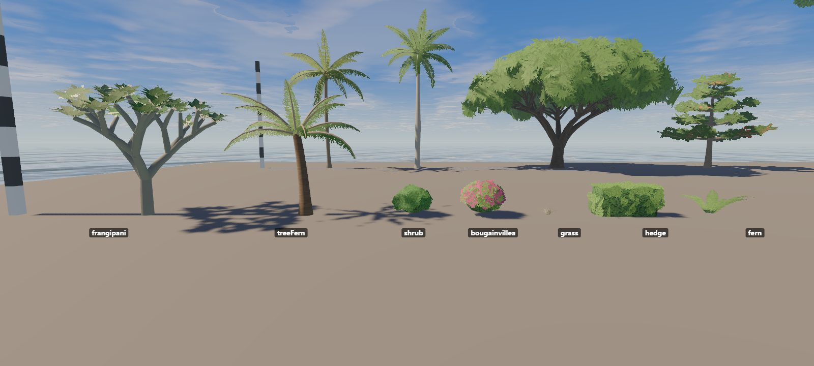

# The city reference

What the city is like, in numbers: the frame, the player, the city's materials, its trees, the sun. Design to
these. The numbers are the host's (the game's code, 2026-11); [`abi.md`](abi.md) is the contract, this file is
how the host behaves within it. Where the host changes, this file changes with it.

The pictures are of the package in [`templates/reference`](../templates/reference) (build it, serve it and open
it in the UGC browser to see it move, at any hour; `shots.mjs` there makes the pictures again).

## 1. The island frame

- Metres, radians. `+y` up, `y = 0` is the sea, the city's decks are at `y = 0.5`.
- **`+z` is the island's front.** The platform's slot turns it into the city: put the entrance and the best view on `+z`. Seen from the front (standing
  at `+z`, looking toward `−z`), `+x` is on your right.
- A heading `h` faces `(sin h, 0, cos h)`: `0` faces `+z`, `π/2` faces `+x`, `π` faces `−z`.
- Footprint `rect`: `w` along `x`, `d` along `z`, centred on the origin.
- In the UGC browser the island is at the world's origin, not turned: the island frame is the world frame
  there (`+x` east, `−z` north). In the city the slot turns it.

## 2. The player

| | value |
|---|---|
| height (top of the head) | 1.75 m |
| radius (walls keep the body's axis this far) | 0.35 m |
| eye height (first person; `lookAt` in the UGC browser) | 1.6 m (the head moves with the walk: 1.55–1.66) |
| the follow camera looks at | the feet + 1.55 m |
| walk / run (Shift) | 4.2 / 7.5 m/s |
| step up (a higher floor or collider top the player walks onto) | 0.62 m or less |
| jump | 7.2 m/s up, gravity 22 m/s²: the feet rise 1.18 m. Landing on anything up to 0.62 m over the feet at the top: a jump reaches a floor about 1.8 m up |
| step down | up to 2.5 m the player walks down (eased); more is a fall |
| a fall that knocks the player down | landing at more than 20 m/s (about 9 m of free fall). Only a look: no damage |
| wading / swimming | wades where the floor is 0.05–0.75 m under the sea; swims deeper |
| climbing out of the sea | onto a cell whose top is 0.1–0.95 m over the sea, within 1.6 m (cells only, not colliders) |
| the act key | **F** (`KeyF`); gamepad Y; a button on touch screens |

How the walls work (all of it in the island frame, `feet` = the player's feet `y`):

- A **collider** is a wall for the player where its prism overlaps the band from `feet + 0.3` to `feet + 1.9`
  (so a door needs 1.9 m of clear height, and more than 0.7 m of width: 1.0 m or more is easy to walk through).
- A **collider whose top is at most `feet + 0.62`** is ground: the player walks up onto it, from 0.5 m away.
  This also holds for the top of a wall beside a stair (docs/ground.md, "Walls beside a stair").
  A collider meant as an obstacle a player cannot stand on must reach more than 0.62 m over the floor round it;
  more than about 1.8 m if they must not jump onto it either.
- A **cell** is never a wall for a walking player: a cell more than 0.62 m over the feet is not there for them
  (they walk under it, or into its column). Walls are colliders. (For a swimmer, a jetpack, a board, a cell is
  a solid column down to the hull.)
- Colliders narrower than 0.6 m that are also lower than 1.6 m or shorter than 1.5 m do not stop the follow
  camera; all others do (the camera's arm stops short of them). Cells stop the camera only from below.
- Trees (`things.json`) do not collide, with the player or the camera. Put a collider round a trunk if it must.
- `surf` changes only the footsteps' sound.

The follow camera: an arm of 5.2 m (6 m when play starts), from the feet + 1.55 m; pitch −1.25 … 1.3 rad; when
something blocks it, it comes in at once (to 0.25 m at the least) and goes out again slowly. In first person
there is no arm.

Act points (abi.md 3.4 `act`): the hint shows, and F gives an `ACT` event, while the player **walks** (not
wading, in the air, swimming), the horizontal distance from the feet to `(x, z)` is less than `r`, and
`|feet − y| < dy` (`dy` 1.5 if not given). So put `y` at the floor's height where the player stands, not at the
thing's height. The nearest act point wins.

## 3. The city's materials

A glTF material named `fc:<name>` is drawn with the city's own material: the same look as the city's buildings,
and the city's night (lamp light pools on it). Your glTF material's colour and textures are not used; the
vertex colour (`COLOR_0`) is: **the colour you see is the vertex colour times the material's texture**.
Without `COLOR_0` it is white.

Each: a 2.2 m cube and a ball with a white vertex colour, and in front a slab with the vertex colour
`[0.85, 0.55, 0.35]`. 15 h: the sun is in the west (left), so the faces toward the camera (`+z`) have only
the sky's light (section 5).

22 h. Only `glow` gives light; the others take the moon's and the sky's light, and the city's lamps where
there are any (none here).

| name | texture (the colour it multiplies) | uv per metre | roughness | other |
|---|---|---|---|---|
| `paving` | stone slabs, about `#e6e2da`, 0.5 m rows | 0.25 | 0.82 | |
| `plaza` | limestone slabs 1 × 0.5 m, joints `#cfc8bb`, a dark (`#5d5a55`) sett frame and centre lines every 16 m | 1/16 | 0.80 | the dark lines show on small things: use it for big floors only |
| `concrete` | cloudy, about `#f2f0ec`, a joint line every 4 m | 0.25 | 0.86 | |
| `plaster` | none (flat white) | — | 0.70 | the vertex colour is the colour |
| `wood` | 16 planks across a texture, light brown `rgb(232, 205, 168)` × 0.85–1 | 0.4 | 0.78 | darkens a colour much: `[0.85, 0.55, 0.35]` comes out a mid brown |
| `sand` | speckled, about `#f3ead6` | 0.2 | 0.95 | |
| `grass` | green, about `#8fb069`, blades | 0.15 | 0.95 | green even with a white vertex colour |
| `metal` | none | — | 0.35 | metalness 0.75: it shows the sky more than its colour |
| `hull` | the concrete's | 0.25 | 0.90 | the city's island sides |
| `glow` | none | — | 0.55 | gives light: vertex colour × 1.4 by day, × 2.24 in the evening, × 0.22 after about 00:12 (the city's decorative lights go off) |
| `gloss` | none | — | 0.22 | shiny |
| `fabric` | none | — | 0.75 | double-sided |

- **uv**: the texture is read at your mesh's `TEXCOORD_0`; the host does not project it. Give each face planar
  uv: its two axes in metres × the "uv per metre" above (`paving`: 1 uv = 4 m). Without uv the texture is read
  at one point: a flat colour.
- All 12 reflect the sky's light at 0.35 (`envMapIntensity`). Your own PBR materials too, unless you give
  `extras.envMapIntensity` (abi.md 2.2; 0–4): the city's glass is 1.5.
- The near look's meshes all cast and take shadows, `fc:glow` too.

### Emissive: what is a good range

The picture is tone-mapped (AgX, exposure about 1.1 by day, 1.45–1.7 at night) and blooms over about 1.6
(linear; about 1.0 at night). Bright light goes white and loses its hue.

Left 6: your own PBR material (base colour 0.3), emissive `[1, 0.72, 0.42]` × the level. Right 6: `fc:glow`,
vertex colour `[1, 0.72, 0.42]` × the level.

- PBR `emissive` is the same by day and night. By day, under about 0.4 it hardly shows; at night 0.05–0.2 is a
  soft warm light that keeps its colour, 0.4 and more is cream to white.
- `fc:glow` follows the city's lights (the table above). At night, a vertex colour of 0.2–0.35 is already a
  bright lamp; 0.65 and more is white with a halo. By day it is light too (× 1.4): not for things that must
  look dark by day (use a PBR emissive, or hide the node by day with `node_visible`).
- For windows and lamps at night: PBR emissive 0.1–0.4, or `fc:glow` with a vertex colour of 0.1–0.35. Keep a
  saturated colour under about 0.3 if its hue matters. (`KHR_materials_emissive_strength` over 1: only for
  light that should be white and bloom.)
- There are no lights you can add (abi.md): a lamp lights only itself. To make a room look lit, give its
  surfaces a little warm emissive (0.03–0.08).

## 4. The trees (`things.json`)

The post at the left is 10 m, in bands of 1 m.

The same post at the left.

At scale 1. A tree's look is one of its kind's variants, chosen by its position (x, z to 0.1 m): you cannot
choose it, but moving a tree by 0.1 m changes it. Heights and crown widths are over the variants.

| kind | variants | height (m) | crown width (m) | |
|---|---|---|---|---|
| `palmCoconut` | 4 | 10.1–12.1 | about 8 | leaning trunk |
| `palmRoyal` | 2 | 13.8–15.0 | about 7 | straight grey trunk |
| `rainTree` | 2 | 12.2–12.5 | about 18.7 | an umbrella; under the crown 5.2–6.4 m clear |
| `frangipani` | 3 | 4.4–4.5 | 4.2–5.7 | branching, flowers (one variant pink) |
| `almond` | 2 | 9.0–9.2 | 8.5–9.7 | tiers of branches from 2.6 m |
| `shrub` | 3 | 0.95–1.16 | 1.2–1.8 | |
| `bougainvillea` | 3 | 0.85–1.29 | 1.3–1.8 | two variants hang down over their `+z` side (to 0.8 / 1.95 m under the foot): for a wall's edge |
| `grass` | 3 | 0.3–1.06 | 0.7–1.7 | |
| `hedge` | 1 | 1.22 | 2.44 along x × 1.23 | |
| `forestTree` | 3 | 21.3–23.0 | 15.3–19.6 | very big: buttress roots to 1.9 m round |
| `treeFern` | 2 | 4.3–5.8 | about 4.4 | |
| `fern` | 3 | 0.75–0.91 | 1.8–2.6 | casts no shadow |
| `birch` | 2 | 9.8–11.0 | 3.6–4.8 | thin white trunk |

- `rotY` turns it about `+y` (a tree's own front is `+z`), `scale` (0.2–3) scales it from its foot. `y` is
  where its foot is: put it on the floor (`0.5` on a deck).
- No collision (section 2). They cast shadows within about 40 m of the camera (more on high quality, none on
  phones); from 180 m they are drawn simpler; they go at 700 m.
- There are no pines, bamboo or willows: make those as meshes.

## 5. The sun, the moon, the hours

The city is on the equator at the equinox. In the **world** frame (`+x` east, `−z` north, `+z` south):

- The sun rises in the east (`+x`) at 6:00, is overhead at 12:00 and sets in the west (`−x`) at 18:00. Toward
  the sun: `(cos a, sin a, 0)`, `a = (hour − 6) · 15°`. It is never north or south of overhead: a face whose
  normal is `±z` (world) never gets direct sun.
- In the city your island is turned by its slot: where the sun comes from in the island frame depends on the
  slot. Do not design for one hour's light from one side. In the UGC browser (not turned): morning light from
  `+x`, afternoon from `−x`.
- The sun's light: 7.0, warm white (`#fff0d8`); orange near the horizon. From about 17:00 to 7:00 the city's
  lights are on (`glow` brighter); `night` (inbox) goes from 0 at 17:12 to 1 at 18:28, and back from 5:32 to
  6:48. After sunset the moon is the light (and casts the shadows): its phase changes every night over 4
  nights, from none to full.
- A game day is 48 minutes (2 minutes an hour).
- Shadows: from the sun (or the moon) only, in 2 cascades fitted to the view: to 300 m on standard quality,
  700 m on high, 220 m on low; none on phones.
- `tod=` (the UGC browser, the game): an hour (`15`, `21.5`, `9:30`) or `dawn` (6.2), `day` (9.0), `dusk`
  (17.8), `night` (20), `late` (4.5). The UGC browser's default is 15.
